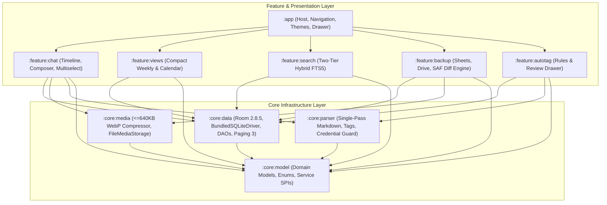
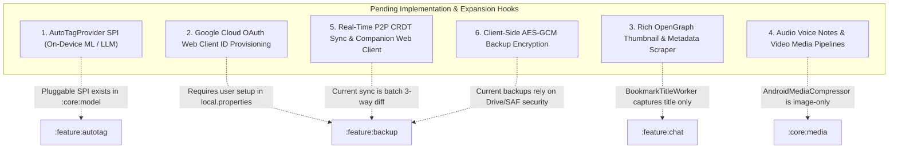

# ThreadLog: Comprehensive User Guide, Formatting Reference & Technical Architecture

> **System**: ThreadLog (`android_journal/`)  
> **Repository**: `k8242/public_agentai`  
> **Application Type**: Native Android (Kotlin, Jetpack Compose, Material 3, Room SQLite FTS5, Paging 3, WorkManager, Hilt)  
> **Package**: `io.github.k8242.threadlog`  
> **License**: MIT  

---

## Table of Contents
1. [System Overview & Core Philosophy](#1-system-overview--core-philosophy)
2. [Complete User Features Reference](#2-complete-user-features-reference)
   - 2.1 [Chat-Stream Timeline](#21-chat-stream-timeline)
   - 2.2 [Task Management (TODOs) & Priorities](#22-task-management-todos--priorities)
   - 2.3 [Taxonomy & Hierarchical Tag Trees](#23-taxonomy--hierarchical-tag-trees)
   - 2.4 [Bidirectional Tag ↔ TODO Cross-Filtering](#24-bidirectional-tag--todo-cross-filtering)
   - 2.5 [Multi-Select Mode & Batch Operations](#25-multi-select-mode--batch-operations)
   - 2.6 [Navigation & Alternative Views](#26-navigation--alternative-views)
   - 2.7 [Composer Backdating & WhatsApp Chat Import](#27-composer-backdating--whatsapp-chat-import)
   - 2.8 [Cloud Sync & Offline Backup](#28-cloud-sync--offline-backup)
3. [Exhaustive Formatting & Syntax Capabilities Reference](#3-exhaustive-formatting--syntax-capabilities-reference)
   - 3.1 [Text Formatting (WhatsApp Markdown)](#31-text-formatting-whatsapp-markdown)
   - 3.2 [Tag Triggers & Escaping Rules](#32-tag-triggers--escaping-rules)
   - 3.3 [URL Parsing & Collapsible Domain Chips](#33-url-parsing--collapsible-domain-chips)
   - 3.4 [Image Compression & Storage Architecture](#34-image-compression--storage-architecture)
   - 3.5 [Sensitive Credential Guard & Masking Rules](#35-sensitive-credential-guard--masking-rules)
   - 3.6 [Visual Annotations & Header Layout](#36-visual-annotations--header-layout)
4. [Technical Architecture & System Design](#4-technical-architecture--system-design)
   - 4.1 [Module Decoupling (10 Gradle Modules)](#41-module-decoupling-10-gradle-modules)
   - 4.2 [Database & Storage Engine (Room + Bundled SQLite FTS5)](#42-database--storage-engine-room--bundled-sqlite-fts5)
   - 4.3 [Paging 3 Fixed Placeholder Architecture](#43-paging-3-fixed-placeholder-architecture)
   - 4.4 [3-Way Dry-Run Diff Engine](#44-3-way-dry-run-diff-engine)
   - 4.5 [Background Processing (WorkManager)](#45-background-processing-workmanager)
5. [Interactive System Glossary](#5-interactive-system-glossary)
6. [Pending Implementation Analysis (Gap Analysis)](#6-pending-implementation-analysis-gap-analysis)

---

## 1. System Overview & Core Philosophy

**ThreadLog** is an offline-first, single-user personal journaling and micro-logging system built for Android. It treats journaling not as formal long-form diary writing, but as a low-friction **chat stream** where thoughts, tasks, photos, links, and milestones are captured in rapid, real-time messages.

### Core Architectural Tenets:
1. **Offline-First & Local Sovereignty**: All data lives locally in SQLite on the user's device. No mandatory remote account, telemetry, or proprietary cloud backend is required.
2. **WhatsApp-Style Familiarity**: Natural messaging UX including reverse-anchored feed, swipe-to-quote replies, quick emoji reactions, lightweight boundary-safe markdown, and 80% bubble width.
3. **Temporal Integrity**: Notes are stamped with monotonic UUID v7 identifiers and anchored with the write-time IANA time zone (e.g., `America/Los_Angeles`), guaranteeing accurate local-calendar representation regardless of subsequent international travel.
4. **Zero Cloud Lock-In**: Backups use open formats—human-readable 3-tab Google Sheets workbooks with Google Drive companion media folders, alongside zero-cloud offline CSV, Excel (.xlsx), and ZIP (JSON + media) archives via Android's Storage Access Framework (SAF).
5. **Zero-Clutter Automation**: Tag suggestion rules and automatic triggers stay hidden until explicitly searched, toggled, or promoted via the Auto-Tag Review Drawer.

---

## 2. Complete User Features Reference

### 2.1 Chat-Stream Timeline
- **Reverse-Anchored Paging**: The feed anchors at the newest entry at the bottom, matching messaging behavior (`LazyColumn(reverseLayout = true)`).
- **4-Tier Hierarchical Dividers**: Grouped chronologically by Year, Month, ISO Week, and Calendar Day.
- **Floating Sticky Period Pill**: Floats at the top during scroll to provide immediate temporal orientation.
- **Monospace Hex-Ordinal Timestamps**: Positioned at the top-left of each message bubble with 0-based chronological hex counter (`0x0`, `0x1`, ..., `0xF`, `0x10`) that resets each local calendar day.
- **Swipe-to-Quote & Clickable Reply Bar**: Swiping a bubble right initiates a reply quote. Clicking the reply bar on a quoted message instantly scrolls the feed to the parent note (switching filters automatically if needed).
- **Soft-Delete & Undo**: Deleting a note marks it with a tombstone (`deletedAtMs`), immediately removing it from view while surfacing an Undo snackbar.

### 2.2 Task Management (TODOs) & Priorities
- **Task Status Lifecycle**: Any note can cycle between `NONE`, `TODO` (open), and `DONE` (completed).
- **1-Tap Inline Checkboxes**: Rendered at the top-start of the bubble. Tapping toggles between TODO and DONE without scrolling or losing list position.
- **4 Task Priorities**:
  - `HIGH`: Vibrant Orange (`#EF6C00` / `#FFA726`) trim & badge.
  - `MEDIUM`: Cobalt Blue (`#1565C0` / `#64B5F6`) trim & badge.
  - `LOW`: Sky Blue (`#29B6F6` / `#81D4FA`) trim & badge.
  - `NONE`: Subtle gray trim.
- **Dedicated TODOs Feed**: Accessible from the left drawer, featuring filter tabs (`Open`, `Done`, `All`) and sorting toggles (`Newest` vs. `Priority`).

### 2.3 Taxonomy & Hierarchical Tag Trees
- **Multi-Root Hierarchies**: Supports 5 root categories: `people/*`, `topics/*`, `projects/*`, `auto/*`, and `other/*`.
- **Disambiguated Leaf Rendering**: Leaf names display cleanly (`Lex`). When multiple branches share a leaf name, `LeafDisambiguator` computes minimal-parent clarification (`Alex (work)` vs. `Alex (school)`).
- **Curated Tag Colors**: 11 color presets (`Coral`, `Amber`, `Emerald`, `Teal`, `Sky`, `Indigo`, `Violet`, `Pink`, `Rose`, `Slate`, `Default`) with dark/light variants that persist across backups.
- **Tag Sorting**: Left drawer and picker sort by `Recent`, `A–Z`, `Most used`, or `Color`.
- **Sub-Tag Navigation Tabs**: Viewing a parent tag with child tags (e.g., `#trips`) automatically surfaces a scrollable sub-tag tab bar (`[All]`, `[#japan]`, `[#france]`).

### 2.4 Bidirectional Tag ↔ TODO Cross-Filtering
- **Filter TODOs by Tag**: Inside the TODOs screen, a dedicated tag filter chip lets users scope tasks to a specific project or topic.
- **Filter Tag Views by TODO Mode**: Inside any Tag view, a two-row filter strip enables viewing only open tasks, completed tasks, or all tasks within that specific tag subtree, complete with priority chips.

### 2.5 Multi-Select Mode & Batch Operations
- Activated via **"Select"** in the context menu or long-press.
- Bubbles display selection checkboxes in the margin, with a primary container highlight on selected rows.
- **Batch Actions Available**:
  - **Copy**: Chronological copy of selected messages to the system clipboard.
  - **Tags**: Bulk attach or detach tags across all selected notes via `QuickTagPickerSheet`.
  - **TODO / Priority**: Bulk toggle TODO status or assign High/Medium/Low priority.
  - **Highlight**: Batch toggle yellow background highlight.
  - **Archive**: Bulk archive with multi-entry Undo snackbar.
  - **Delete**: Bulk soft-delete with multi-entry Undo snackbar.

### 2.6 Navigation & Alternative Views
- **Hidable Left Drawer (`ThreadLogDrawer`)**: Replaces clunky bottom bars. Contains search, topic/tag tree summaries with unread count badges, auto-tag review access, and a quick theme switcher (7 color schemes).
- **Compact Weekly View (`CompactWeeklyScreen`)**: Renders a 1-line 140-character summary per note with ellipses and 1-tap inline expansion. Shows TODO indicators, priority trims, and highlight fills.
- **Monthly Calendar View (`CalendarScreen`)**: Displays a monthly grid with density dots for note activity, distinct orange dots for open tasks, and an interactive day inspector.
- **Two-Tier Hybrid Search (`SearchScreen`)**:
  - **Tier A (<= 5 weeks)**: Powers an in-feed stepper jumping directly to the message bubble in the main chat.
  - **Tier B (> 5 weeks)**: Renders compact search cards that open an interactive `±12h` Context Window.
- **Timeline Scrubber**: Google Photos-style right-edge scrollbar with floating date pill during drag, Jump-to-Beginning (`VerticalAlignTop`), and Jump-to-End (`KeyboardArrowDown`) buttons.

### 2.7 Composer Backdating & WhatsApp Chat Import
- **Composer Backdate Picker**: Direct Date / Time / IANA Timezone modal with a *"Keep date for next note (+1 min each)"* option for consecutive historical entries.
- **WhatsApp Chat Importer**: Parses Android and iOS WhatsApp chat export text or `.txt` files with interactive review, customizable date order (`M/D/YY` vs. `D/M/YY`), sender prefix stripping, `<Media omitted>` filtering, and credential guard validation.

### 2.8 Cloud Sync & Offline Backup
- **Google Sheets & Drive Sync**: Stores structured notes in a 3-tab workbook (`Entries`, `TagTree`, `SyncMeta`) and images in `ThreadLog_Media/` via the minimal `drive.file` OAuth scope.
- **3-Way Dry-Run Diff Engine**: Computes SHA-256 hashes across Local, Remote, and Base snapshots, presenting a diff modal before committing changes.
- **Offline Codecs**: Export and import full journal databases as CSV, XLSX, or ZIP (JSON database + media directory) via Android SAF with zero cloud dependencies.

---

## 3. Exhaustive Formatting & Syntax Capabilities Reference

### 3.1 Text Formatting (WhatsApp Markdown)

ThreadLog implements a custom single-pass parser ([`DefaultMessageParser.kt`](../core/parser/src/main/kotlin/io/github/k8242/threadlog/core/parser/DefaultMessageParser.kt)) matching WhatsApp boundary rules:

| Formatting | Syntax | Example Input | Rendered Result | Boundary Rules |
| :--- | :--- | :--- | :--- | :--- |
| **Bold** | `*text*` | `*urgent meeting*` | **urgent meeting** | Cannot be bordered by alphanumerics (e.g. `a*b*c` ignored). |
| *Italic* | `_text_` | `_reading notes_` | *reading notes* | Underscores in URLs or words are ignored. |
| ~Strikethrough~ | `~text~` | `~cancelled plan~` | ~~cancelled plan~~ | Inner spaces at boundaries prevent formatting (`~ text ~`). |
| `Inline Code` | `` `text` `` | `` `val key = 123` `` | Monospace pill | Verbatim formatting; internal markers are ignored. |
| Code Block | ```` ```code``` ```` | ```` ```kotlin\nprintln()\n``` ```` | Multi-line syntax card | Triple backtick fence with optional language identifier. |
| Blockquote | `> text` | `> Remember this axiom` | Indented bar quote | Consecutive lines starting with `>` are grouped. |

### 3.2 Tag Triggers & Escaping Rules
- `@` **People Trigger**: Typing `@` triggers autocomplete scoped to `people/*`. Selecting an option inserts the leaf name; upon sending, the text is cleaned and the tag is attached as a structured entity.
- `#` **Topic Trigger**: Searches across all tags (`topics/*`, `projects/*`, `people/*`).
- `+` **Project Trigger**: Dedicated prefix for `projects/*` (e.g. `+apollo`). Arithmetic expressions like `2+2` or `+1` are ignored.
- `\` **Backslash Escaping**: Prefixing a symbol with `\` (e.g. `\@alice`, `\#topic`, `\+project`) outputs the literal character without triggering tags.

### 3.3 URL Parsing & Collapsible Domain Chips
- URLs matching `http://` or `https://` are automatically detected, extracted from the raw body, and presented as compact, interactive domain chips (e.g., `github.com ↗`).
- Trailing punctuation (`,`, `.`, `!`, `?`) and balanced parentheses are intelligently stripped from the URL.
- When `offlineOnlyLinks` is disabled, `BookmarkTitleWorker` fetches the webpage's HTML `<title>` asynchronously in the background.

### 3.4 Image Compression & Storage Architecture
- Attached or pasted images pass through [`AndroidMediaCompressor.kt`](../core/media/src/main/kotlin/io/github/k8242/threadlog/core/media/AndroidMediaCompressor.kt).
- **Processing Steps**:
  1. EXIF orientation detection and upright rotation.
  2. Downscaling to a maximum dimension of `2048px`.
  3. Quality-stepped WebP lossy compression guaranteeing `byteSize <= 655,360` bytes (640 KiB).
  4. SHA-256 deduplication and atomic temporary file rename (`tmp -> fsync -> media/<uuid>.webp`).

### 3.5 Sensitive Credential Guard & Masking Rules
To prevent accidental leakage of secrets in notes and backups, [`SensitiveCredentialGuard.kt`](../core/parser/src/main/kotlin/io/github/k8242/threadlog/core/parser/SensitiveCredentialGuard.kt) validates note bodies on both create and edit:
- **Blocked Keywords**: `password`, `passwd`, `passcode`, `passphrase`, `pw`, `p/w`, `pin`, `pincode`, `pin code`, `pin#` when followed by values via `:`, `=`, `->`, `is`, or direct spacing.
- **Unix Command Exemption**: `pwd` is explicitly allowed (common terminal command).
- **Masking Exception**: Any value matching `^[xX]{4,}$` (e.g., `pw: xxxx`, `PIN: XXXX`) is permitted.
- **UX Remediation**: The composer surfaces a warning banner with a **"Mask xxxx"** 1-tap action that replaces detected credentials with `xxxx`.

### 3.6 Visual Annotations & Header Layout
- **Yellow Highlight**: Applies `#FFF8D6` (Light) / `#3D3518` (Dark) background tint to the bubble without modifying the note's `updatedAtMs` (preserving original edit status).
- **Upper-Left Monospace Cluster**:
  ```
  0x3 · 10:14 AM · Edited 10:20 AM  [TODO] [HIGH]
  ```
  Renders using a wrapping `FlowRow` to prevent collisions on narrow or foldable screens.

---

## 4. Technical Architecture & System Design



### 4.1 Module Decoupling (10 Gradle Modules)
The project enforces strict separation with **zero feature-to-feature dependencies**:
- **`:core:model`**: Pure JVM library with zero Android dependencies. Contains immutable entities, enums, AST nodes, and SPI contracts.
- **`:core:parser`**: Pure JVM parser for WhatsApp formatting, URL regex, tag trigger detection, and credential guards.
- **`:core:media`**: Android library for EXIF rotation, WebP compression, and disk storage.
- **`:core:data`**: Room SQLite database, DAOs, Paging sources, repositories, and DataStore settings.
- **`:feature:*`**: Decoupled UI modules communicating only via navigation arguments and `:core:model` interfaces.
- **`:app`**: Top-level orchestrator wiring Hilt dependency injection, `NavHost`, and theme configurations.

### 4.2 Database & Storage Engine (Room + Bundled SQLite FTS5)
- Uses **Room 2.8.5** with **`BundledSQLiteDriver`**, ensuring identical C-level SQLite behavior across all Android OEM versions (bypassing vendor SQLite quirks).
- **FTS5 Integration**: An external content FTS5 virtual table indexes `body_plain` and associated tag paths for sub-millisecond prefix and full-text queries.
- **Database Migrations**: Incremental, non-destructive migrations (`MIGRATION_1_2` through `MIGRATION_3_4`) handle schema evolutions (reactions JSON, task priorities, highlight flags, archive timestamps).

### 4.3 Paging 3 Fixed Placeholder Architecture
In reverse-anchored feeds (`reverseLayout = true`), toggling a task in historical notes often causes index collapse in naive Paging 3 setups. ThreadLog configures:
```kotlin
PagingConfig(
    pageSize = 30,
    enablePlaceholders = true,
    jumpThreshold = 60,
    maxSize = 300
)
```
Combined with fixed-height `MessageBubblePlaceholder()` slots, database row `k` remains permanently at LazyColumn index `k`, completely eliminating scroll jumps.

### 4.4 3-Way Dry-Run Diff Engine
Before remote changes from Google Sheets or imported ZIPs overwrite local storage, [`SyncDiffEngine.kt`](../feature/backup/src/main/kotlin/io/github/k8242/threadlog/feature/backup/sync/SyncDiffEngine.kt) computes a 3-way diff between **Base**, **Local**, and **Remote** states:
- Matches entries by UUID v7.
- Compares SHA-256 `contentHash`.
- Categorizes operations into `ADD_LOCAL`, `ADD_REMOTE`, `UPDATE_LOCAL`, `UPDATE_REMOTE`, `DELETE`, and `CONFLICT`.
- Surfaces an interactive Dry-Run Diff screen allowing per-conflict resolution.

---

## 5. Interactive System Glossary

An interactive, filterable glossary web application is bundled at [`system_glossary.html`](system_glossary.html) for real-time querying across terms, formatting rules, architecture components, and security guardrails.

### Static Glossary Reference Table

| Category | Term | Module | Description & Syntax |
| :--- | :--- | :--- | :--- |
| **Formatting** | `*bold*` | `:core:parser` | WhatsApp-style bold text delimited by single asterisks outside alphanumeric boundaries. |
| **Formatting** | `_italic_` | `:core:parser` | WhatsApp-style italic text; ignores underscores inside URLs or query strings. |
| **Formatting** | `~strike~` | `:core:parser` | Strikethrough text styling for completed or deprecated notes. |
| **Formatting** | `` `code` `` | `:core:parser` | Inline monospace code span rendered verbatim without evaluating inner markers. |
| **Formatting** | ```` ```block``` ```` | `:core:parser` | Fenced multi-line code block with optional syntax highlighting language tag. |
| **Formatting** | `> quote` | `:core:parser` | Consecutive lines starting with `>` grouped into an indented quote card with vertical bar. |
| **Formatting** | `@person` | `:core:parser` | Triggers autocomplete scoped strictly to the `people/*` hierarchy; auto-attached on send. |
| **Formatting** | `#topic` | `:core:parser` | Triggers autocomplete across all tags (`topics/*`, `projects/*`, `people/*`). |
| **Formatting** | `+project` | `:core:parser` | Dedicated trigger for `projects/*` hierarchy; arithmetic like `2+2` is ignored. |
| **Formatting** | `\@`, `\#`, `\+` | `:core:parser` | Backslash escaping allowing literal usage of symbols without tag creation. |
| **Formatting** | Yellow Highlight | `:core:model` | Warm soft yellow tint (`#FFF8D6` / `#3D3518`) preserving note's original `updatedAtMs`. |
| **Formatting** | Hex Ordinal | `:feature:chat` | Chronological per-day 0-based hex counter (`0x0`, `0x1`...) reset each midnight. |
| **Feature** | Chat Feed | `:feature:chat` | Reverse-anchored Paging 3 timeline with 4-tier dividers and floating period pill. |
| **Feature** | Task / TODO | `:core:model` | `NONE`, `TODO`, `DONE` task states with 1-tap inline checkbox and strikethrough styling. |
| **Feature** | Task Priority | `:core:model` | `HIGH` (orange), `MEDIUM` (dark blue), `LOW` (light blue), `NONE` with color trim & sorting. |
| **Feature** | Multi-Select | `:feature:chat` | Bulk selection mode for chronological copy, batch tagging, priority, and archive/delete. |
| **Feature** | Sub-Tag Tabs | `:feature:chat` | Secondary scrollable tabs generated under parent tag views (e.g. `#trips` -> `[#japan]`). |
| **Feature** | Cross-Filtering | `:feature:chat` | Bidirectional filtering: filter TODOs by tag, or filter tags by TODO state & priority. |
| **Feature** | Scrubber | `:feature:chat` | Right-edge timeline scrollbar with floating date pill and Begin/End quick jump buttons. |
| **Architecture** | UUID v7 | `:core:parser` | 128-bit time-ordered unique identifiers ensuring chronological B-tree locality. |
| **Architecture** | IANA Timezone | `:core:model` | Write-time time zone anchoring (`zoneId`) preserving true local calendar dates. |
| **Architecture** | Bundled FTS5 | `:core:data` | Room 2.8.5 with `BundledSQLiteDriver` guaranteeing uniform FTS5 full-text indexing. |
| **Architecture** | Content Hash | `:core:parser` | SHA-256 digest computed across normalized message content to power 3-way sync diffs. |
| **Security** | Credential Guard | `:core:parser` | RegEx/keyword engine blocking passwords and PINs unless masked with `xxxx`. |
| **Backup** | 3-Way Diff | `:feature:backup` | Compares Base vs Local vs Remote snapshots to prevent accidental cloud overwrites. |

---

## 6. Pending Implementation Analysis (Gap Analysis)

A thorough audit of the codebase, planning artifacts, and issue trackers reveals the exact implementation status of all system components:

### A. 100% Implemented & Production-Ready Elements
- **Core Timeline & Messaging**: Reverse-anchored Paging 3, WhatsApp formatting, swipe-to-quote, emoji reactions, 80% bubble width, hex-ordinal timestamps, floating period pill, timeline scrubber, and begin/end jump FABs.
- **Task Management**: TODO/DONE toggles, 4 task priorities with color trims, dedicated TODO view, and bidirectional TODO ↔ Tag cross-filtering.
- **Taxonomy Engine**: Multi-root tag trees, leaf disambiguation, 11 tag color palettes, 4 tag sort orders, sub-tag tabs, and multi-select batch tagging.
- **Security & Privacy**: `SensitiveCredentialGuard` keyword engine, `xxxx` masking exception, 1-tap "Mask xxxx" UI remediation, and public repository gitignore rules.
- **Search & Views**: Two-Tier Hybrid Search (Tier A stepper + Tier B context window), Compact Weekly View with 140-char truncation, and Monthly Calendar View with density dots.
- **Import & Backup**: Native WhatsApp chat export parser & review screen, 3-tab Google Sheets sync, `ThreadLog_Media/` Drive sync, 3-way Dry-Run Diff Engine, and offline SAF CSV/XLSX/ZIP codecs.

---

### B. Pending Implementation & Architectural SPI Hooks

The following items are either architectural hooks designed for future extension, external setup requirements, or deferred features:



1. **AutoTagProvider ML / On-Device LLM Provider (`:feature:autotag`)**:
   - *Current State*: The system defines a pluggable `AutoTagProvider` SPI in `:core:model/contract/ServiceContracts.kt`, currently bound via Hilt to `OfflineRuleAutoTagger` (deterministic keyword, domain, and regex matching).
   - *Pending Implementation*: Implementing an on-device neural or LLM provider (such as Gemini Nano via Android AICore) to generate semantic tag suggestions without cloud transmission.

2. **Google Cloud OAuth Web Client ID Provisioning (`:feature:backup`)**:
   - *Current State*: All OkHttp REST clients and Sheets/Drive sync routines are fully implemented. However, because `public_agentai` is a public open-source repository, no default Google Client ID/secret is committed.
   - *Pending Action*: End-users wishing to use Google Sheets/Drive cloud sync must manually configure a Google Cloud project with the `drive.file` scope and supply `GOOGLE_WEB_CLIENT_ID` in their local `local.properties`. (Offline SAF CSV/XLSX/ZIP export works immediately with zero configuration).

3. **Rich OpenGraph Link Previews (`:feature:chat`)**:
   - *Current State*: `BookmarkTitleWorker` extracts URLs and asynchronously scrapes `<title>` tags over HTTP (with an offline-only toggle).
   - *Pending Implementation*: Parsing rich OpenGraph metadata (`og:image`, `og:description`, `twitter:card`) and caching external link preview thumbnails.

4. **Audio Voice Notes & Video Media Pipelines (`:core:media`)**:
   - *Current State*: The media pipeline (`AndroidMediaCompressor` and `FileMediaStorage`) is specialized for still photos (EXIF orientation correction, <= 2048px downscaling, <= 640 KiB lossy WebP compression).
   - *Pending Implementation*: Media recording/compression pipelines for audio voice memos (`.m4a` / Opus) and short video clips.

5. **Real-Time Peer-to-Peer CRDT Sync & Companion Web Client**:
   - *Current State*: Sync is asynchronous and workbook-based via 3-way diff against Google Sheets or SAF files.
   - *Pending Implementation*: Real-time peer-to-peer synchronization (e.g., using CRDTs over WebRTC) and a desktop web application interface.

6. **Client-Side At-Rest Encryption for Backups (`:feature:backup`)**:
   - *Current State*: Notes are protected in-memory by `SensitiveCredentialGuard`, and cloud backups are scoped to the user's private Google account.
   - *Pending Implementation*: Optional password-derived AES-256-GCM encryption for exported ZIP, CSV, and XLSX backup files.
