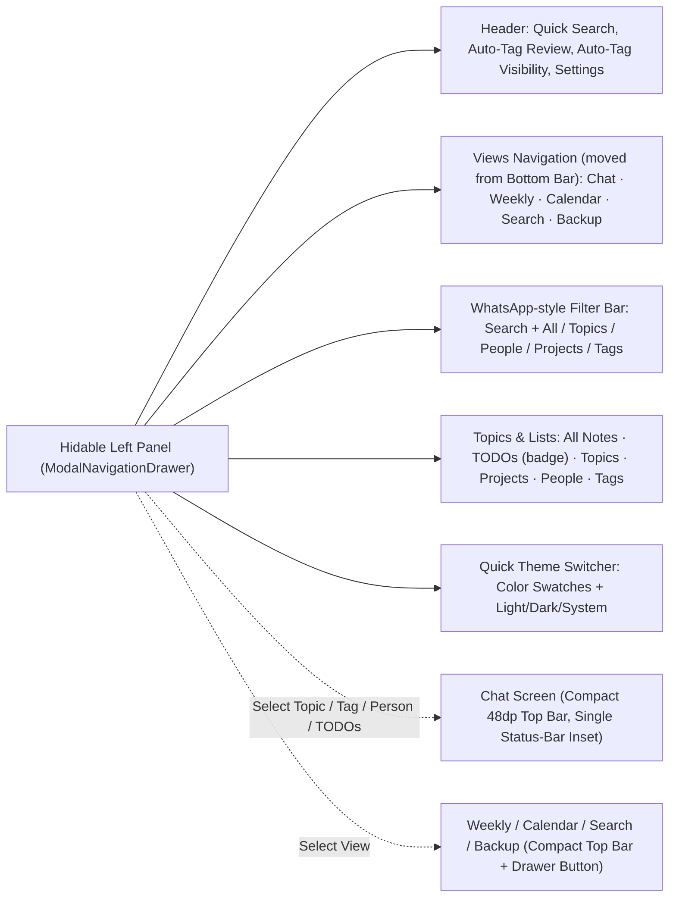

# ThreadLog Feature Plan: Hidable Left Panel, Color Schemes, TODOs & Layout

- **Date:** 2026-11-22
- **Type:** Feature
- **Status:** Implemented (`76348c2`)

This plan covers the first major feature upgrade for the Android journal app (`android_journal` / ThreadLog) across `:core:model`, `:core:data`, `:feature:chat`, `:feature:views`, `:feature:search`, `:feature:backup`, and `:app` (including expanding note bubbles to 80% of available screen width).

---

## Summary of Architecture & Layout Changes

---

## 1. Fix Dead Empty Space Above Top Nav Bar (Req #4)

### Root Cause
In [ThreadLogApp.kt](../../../app/src/main/kotlin/io/github/k8242/threadlog/app/ui/ThreadLogApp.kt), an outer `Scaffold` applied `innerPadding` (which includes `WindowInsets.statusBars` from `enableEdgeToEdge()`) to `NavHost`. Every child screen (`ChatScreen`, `CompactWeeklyScreen`, `CalendarScreen`, `SearchScreen`, `AutoTagReviewScreen`, `ContextWindowScreen`, `SettingsScreen`) then nested its own `Scaffold` + `TopAppBar`, applying `statusBars` insets a **second time** — leaving a blank gap above every top bar.

### Planned Changes
- **Single-owner inset architecture**: Remove the outer `Scaffold` in [ThreadLogApp.kt](../../../app/src/main/kotlin/io/github/k8242/threadlog/app/ui/ThreadLogApp.kt) and host `NavHost` directly inside the `ModalNavigationDrawer` content container (`WindowInsets(0)` at the root).
- **Compact top header on Chat**: Replace the 64dp Material 3 `TopAppBar` in [ChatScreen.kt](../../../feature/chat/src/main/kotlin/io/github/k8242/threadlog/feature/chat/ui/ChatScreen.kt) with a compact ~48dp top header bar (`Modifier.statusBarsPadding()`) flush below the system status bar containing only:
  - Left drawer toggle button (`Menu` icon, with optional small dot indicator if auto-tags are pending).
  - Active topic/filter title (e.g., `ThreadLog`, `TODOs`, `#ideas`, `@Lex`) + subtle subtitle/count.
  - Contextual right action only when filtered (e.g., a compact `All` / clear-filter chip).
- **Consistent compact headers across other top-level screens**:
  - Add a drawer-toggle `navigationIcon` to [CompactWeeklyScreen.kt](../../../feature/views/src/main/kotlin/io/github/k8242/threadlog/feature/views/weekly/CompactWeeklyScreen.kt), [CalendarScreen.kt](../../../feature/views/src/main/kotlin/io/github/k8242/threadlog/feature/views/calendar/CalendarScreen.kt), [SearchScreen.kt](../../../feature/search/src/main/kotlin/io/github/k8242/threadlog/feature/search/ui/SearchScreen.kt), and [BackupScreen.kt](../../../feature/backup/src/main/kotlin/io/github/k8242/threadlog/feature/backup/ui/BackupScreen.kt) (which previously had no top bar), each applying `statusBars` insets **once**.
  - Ensure `ChatComposer` handles bottom insets cleanly with no bottom bar competing for space.
- **80% note bubble width**: Size message bubbles in [ChatMessageComponents.kt](../../../feature/chat/src/main/kotlin/io/github/k8242/threadlog/feature/chat/ui/ChatMessageComponents.kt) to `fillMaxWidth(0.80f)` to take advantage of available horizontal space.

---

## 2. Hidable Left Panel + Moved Top & Bottom Nav Areas (Req #1 & #2)

### Navigation Consolidation
- **Remove permanent bottom `NavigationBar`** from [ThreadLogApp.kt](../../../app/src/main/kotlin/io/github/k8242/threadlog/app/ui/ThreadLogApp.kt).
- **Move Chat top-bar utility actions** (Search, Auto-Tag Review with badge, Show/Hide pending auto-tags toggle, Settings) into the hidable left panel header.
- **Move bottom-bar views** (Chat, Weekly, Calendar, Search, Backup) into a compact navigation strip inside the left panel.

### WhatsApp-Style Topics, Tags & People List
Create a dedicated `ThreadLogDrawer` composable + `DrawerViewModel` in `:app` backed by efficient SQLite summary queries in `:core:data`:
- **Pinned top items**:
  1. **All Notes** — full unfiltered timeline, showing total note count and latest note snippet.
  2. **TODOs** — task notes topic (Req #5), showing an accent badge with the open TODO count and latest open task preview.
- **Inline search + category filter pills**:
  - Compact search box inside the panel to quickly filter topics/tags/people.
  - Filter chips: **`All` · `Topics` · `People` · `Projects` · `Tags`**.
- **Conversation-style rows**:
  - Each tag/person/project renders like a WhatsApp list row: colored circular avatar (initials/category icon using `colorToken`), disambiguated name via `LeafDisambiguator` (`@Lex` for People, `#ideas` for Topics/Projects/Tags), latest entry preview or parent path subtitle, and note count badge.
- **Selecting a topic/tag/person/TODOs**:
  - Updates the active `ChatFeedFilter` (`All`, `Todos(filterMode)`, or `TagSubtree(tagId, fullPath, displayLabel)`), navigates to `ThreadLogRoute.Chat` if currently on another screen, and closes the drawer.
  - Selecting a tag or TODOs also filters the `ChatScreen` Paging stream via SQLite queries (`EntryDao`).
- **Gesture coexistence with swipe-to-reply**:
  - [MessageBubbleItem](../../../feature/chat/src/main/kotlin/io/github/k8242/threadlog/feature/chat/ui/ChatMessageComponents.kt) uses horizontal drag for swipe-to-reply. To prevent gesture conflicts, `ModalNavigationDrawer` keeps swipe-to-close enabled when open (`gesturesEnabled = drawerState.isOpen || !isOnChatScreen`) and provides a dedicated left-edge swipe strip (~24dp) on Chat + the top-left menu button so both drawer-open and bubble swipe-to-reply work reliably.

---

## 3. Multi-Color-Scheme Support (Req #2)

### Models & Persistence (`:core:model`, `:core:data`)
- Add enums to [DomainEnums.kt](../../../core/model/src/main/kotlin/io/github/k8242/threadlog/core/model/DomainEnums.kt):
  - `AppColorScheme`: `TEAL` (default), `WHATSAPP` (Forest/WhatsApp green), `OCEAN` (Deep Cobalt), `SUNSET` (Warm Terracotta), `LAVENDER` (Plum/Indigo), `MONOCHROME` (Minimal Ink), `DYNAMIC` (Material You on Android 12+).
  - `ThemeMode`: `SYSTEM` (default), `LIGHT`, `DARK`.
- Extend [UserSettings](../../../core/model/src/main/kotlin/io/github/k8242/threadlog/core/model/DomainModels.kt) with `colorScheme` and `themeMode` (defaulted for full compatibility).
- Add `setColorScheme` and `setThemeMode` to [SettingsRepository](../../../core/model/src/main/kotlin/io/github/k8242/threadlog/core/model/contract/RepositoryContracts.kt) and [DataStoreSettingsRepository](../../../core/data/src/main/kotlin/io/github/k8242/threadlog/core/data/repository/DataStoreSettingsRepository.kt).

### Theme Engine & UI (`:app`)
- Expand [ThreadLogTheme.kt](../../../app/src/main/kotlin/io/github/k8242/threadlog/app/ui/theme/ThreadLogTheme.kt) with curated light and dark Material 3 `ColorScheme` definitions for every `AppColorScheme`, including tuned `surfaceContainer*` tokens for chat bubbles and drawer surfaces.
- Observe `UserSettings` at the app root in [MainActivity.kt](../../../app/src/main/kotlin/io/github/k8242/threadlog/app/MainActivity.kt) and update `enableEdgeToEdge(...)` system bar contrast dynamically when `isDark` changes.
- Add an **Appearance** section (Theme mode chips + color-swatch cards) in [SettingsScreen.kt](../../../app/src/main/kotlin/io/github/k8242/threadlog/app/ui/settings/SettingsScreen.kt) AND a compact **quick theme switcher** (color swatches + light/dark toggle) in the footer of the hidable left panel.

---

## 4. Scroll Existing Notes Up When Adding a Note (Req #3)

### Root Cause
In [ChatScreen.kt](../../../feature/chat/src/main/kotlin/io/github/k8242/threadlog/feature/chat/ui/ChatScreen.kt), `LazyColumn(reverseLayout = true)` keys items by `entry.id`. When a new entry is inserted at index `0`, Compose's key-based scroll anchoring shifts `firstVisibleItemIndex` from `0` to `1` to keep the previous bottom item pinned — leaving the new note off-screen below and failing to scroll existing notes upward. Additionally, sending a note while scrolled up in history never scrolls back to the newest item.

### Planned Changes
- Emit a pending `scrollToNewestEntryId: String?` state/event in [ChatViewModel.kt](../../../feature/chat/src/main/kotlin/io/github/k8242/threadlog/feature/chat/ui/ChatViewModel.kt) upon successful `createEntry(...)`.
- In [ChatScreen.kt](../../../feature/chat/src/main/kotlin/io/github/k8242/threadlog/feature/chat/ui/ChatScreen.kt), observe `scrollToNewestEntryId` alongside `lazyPagingItems.itemSnapshotList`: once the created entry lands at index `0` (or its index in the snapshot), call `listState.animateScrollToItem(targetIndex)` and clear the pending scroll request — smoothly pushing all existing notes upward as the new note appears at the bottom.
- **Filter-aware creation**: When adding a note while viewing a specific tag/topic/person or the `TODOs` topic, automatically pre-apply that tag (or `TaskStatus.TODO`) in the composer (shown as a removable chip) so the newly sent note belongs to the active view and immediately appears at index `0`.

---

## 5. Task Toggling of Notes into TODOs (Req #5)

### Data Model & Database Migration (`:core:model`, `:core:data`, `:feature:backup`)
- Add `TaskStatus` enum (`NONE`, `TODO`, `DONE`) to [DomainEnums.kt](../../../core/model/src/main/kotlin/io/github/k8242/threadlog/core/model/DomainEnums.kt) and `taskStatus: TaskStatus = TaskStatus.NONE` to [Entry](../../../core/model/src/main/kotlin/io/github/k8242/threadlog/core/model/DomainModels.kt) (with helpers `isTask` and `isTaskDone`).
- Add `task_status TEXT NOT NULL DEFAULT 'NONE'` + index to [EntryEntity](../../../core/data/src/main/kotlin/io/github/k8242/threadlog/core/data/local/entity/Entities.kt).
- Bump [ThreadLogDatabase](../../../core/data/src/main/kotlin/io/github/k8242/threadlog/core/data/local/ThreadLogDatabase.kt) to `version = 2` with an explicit non-destructive `MIGRATION_1_2` registered in [DataDiModule.kt](../../../core/data/src/main/kotlin/io/github/k8242/threadlog/core/data/di/DataDiModule.kt) and export `schemas/.../2.json`.
- Extend [EntryRepository](../../../core/model/src/main/kotlin/io/github/k8242/threadlog/core/model/contract/RepositoryContracts.kt) and [DefaultEntryRepository](../../../core/data/src/main/kotlin/io/github/k8242/threadlog/core/data/repository/DefaultEntryRepository.kt):
  - `createEntry(..., taskStatus: TaskStatus = TaskStatus.NONE)`
  - `setTaskStatus(entryId: String, taskStatus: TaskStatus, nowMs: Long = ...)`
  - `observePagedEntries(filter: ChatFeedFilter = ChatFeedFilter.All)` supporting `All`, `TagSubtree(tagPath)`, and `Todos(mode)`
  - `observeDrawerOverview()` & `observeDrawerTagSummaries()` returning total count, open TODO count, latest snippets, and per-tag counts/latest previews.
- **Backup & Sync preservation**: Add optional `taskStatus: String = "NONE"` (`task_status` column) to [SheetEntryRow](../../../core/model/src/main/kotlin/io/github/k8242/threadlog/core/model/SyncModels.kt), [WorkbookMapper](../../../feature/backup/src/main/kotlin/io/github/k8242/threadlog/feature/backup/sync/WorkbookMapper.kt), [DefaultBackupDataGateway](../../../core/data/src/main/kotlin/io/github/k8242/threadlog/core/data/repository/DefaultBackupDataGateway.kt), and `EntryContentHasher` (only hashing `task_status` when `!= NONE` so existing v1 sync hashes stay backward compatible).

### Task UI & Interactions (`:feature:chat`)
- **Message bubble ([ChatMessageComponents.kt](../../../feature/chat/src/main/kotlin/io/github/k8242/threadlog/feature/chat/ui/ChatMessageComponents.kt))**:
  - Overflow / long-press menu: **"Mark as TODO"** (if `NONE`) or **"Remove TODO"** (if `TODO`/`DONE`).
  - When a note is a TODO (`TODO` or `DONE`), display a 1-tap checkbox inline at the top-start of the bubble to toggle `TODO <-> DONE`.
  - Visual cues: subtle accent border/badge for open `TODO`, checked box + muted strikethrough styling for `DONE`.
- **Composer ([ChatComposerComponents.kt](../../../feature/chat/src/main/kotlin/io/github/k8242/threadlog/feature/chat/ui/ChatComposerComponents.kt))**:
  - Compact task toggle icon button (`CheckBoxOutlineBlank` / `CheckBox`) to compose a new note directly as a TODO.
- **Left Panel TODOs Topic**:
  - Dedicated **TODOs** entry pinned under **All Notes** with live open count badge.
  - When viewing **TODOs**, show a slim filter strip (`Open` · `Done` · `All`) right below the compact top bar.

---

## Verification Plan
1. **Database & Repository unit tests** (`:core:data`):
   - `MIGRATION_1_2` schema migration test (v1 -> v2 preserves existing rows with `task_status = 'NONE'`).
   - Task status toggling (`NONE -> TODO -> DONE -> NONE`), filtered paging (`All`, tag subtree, `TODOs` open/done/all), and drawer summary counts/previews.
   - `DataStoreSettingsRepository` persistence for `AppColorScheme` and `ThemeMode`.
2. **ViewModel unit tests** (`:feature:chat`, `:app`):
   - `ChatViewModel` tests for filter switching, auto-attaching active tag/TODO on send, `scrollToNewestEntryId` emission on note creation, and task toggling.
3. **Backup/Sync codec tests** (`:feature:backup`):
   - CSV/XLSX/ZIP round-trip with `task_status`, plus backward-compatible import of v1 files lacking `task_status`.
4. **Full build & verification checks**:
   - `./gradlew checkLicenseHeaders` (SPDX MIT header compliance on all new/modified `.kt` files)
   - `./gradlew testDebugUnitTest` across all modules
   - `./gradlew :app:assembleDebug`
